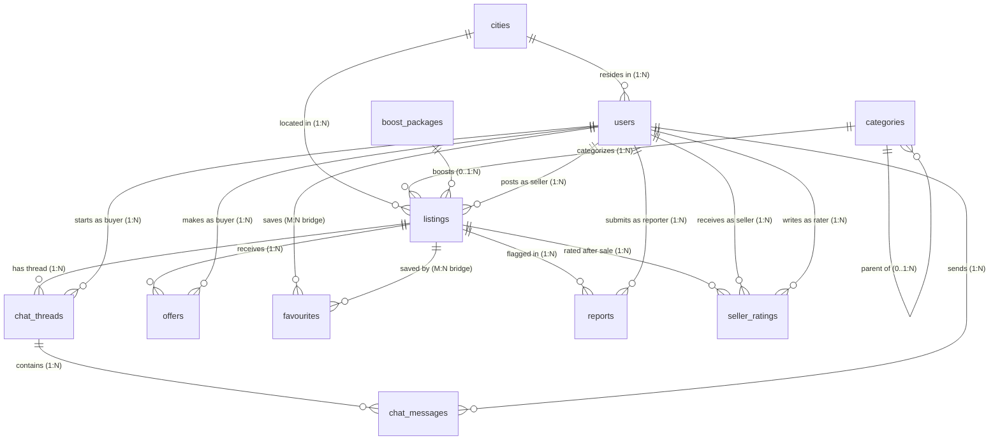

# Phase 2: Schema Design, Constraints, and Normalization

All 11 tables are created inside the `olx` schema (`SET search_path TO olx;`) in [sql/01_schema.sql](../sql/01_schema.sql) and loaded cleanly from `seed_data/` in [sql/02_load_data.sql](../sql/02_load_data.sql). Per Phase 2 rules, **only** `PRIMARY KEY`, `FOREIGN KEY`, `UNIQUE`, `NOT NULL`, and `CHECK` constraints are defined—no secondary tuning indexes exist yet so that Phase 3 captures a true untuned baseline.

---

## 1. Entity-Relationship Diagram

Rendered diagram: [diagrams/er_diagram.png](../diagrams/er_diagram.png)



### Relationship Cardinalities

- `cities` → `users` (`1:N`), `cities` → `listings` (`1:N`)
- `categories` → `categories` (`0..1:N` self-referential hierarchy: 5 top-level categories, 7 sub-categories)
- `categories` → `listings` (`1:N`)
- `boost_packages` → `listings` (`0..1:N`; optional paid boost)
- `users` → `listings` (`1:N` via `seller_id`)
- `users` ↔ `listings` via `favourites` (`M:N` resolved with composite PK `(user_id, listing_id)`)
- `listings` → `chat_threads` (`1:N`) and `users` → `chat_threads` (`1:N` via `buyer_id`, unique per `(listing_id, buyer_id)`)
- `chat_threads` → `chat_messages` (`1:N`) and `users` → `chat_messages` (`1:N` via `sender_id`)
- `listings` → `offers` (`1:N`) and `users` → `offers` (`1:N` via `buyer_id`; multiple offers/counters allowed per buyer)
- `listings` → `reports` (`1:N`) and `users` → `reports` (`1:N` via `reporter_id`, unique per `(listing_id, reporter_id)`)
- `listings` → `seller_ratings` (`1:N`), `users` → `seller_ratings` (`1:N` as `seller_id` and `1:N` as `rater_id`, unique per `(listing_id, rater_id)`)

---

## 2. Data Dictionary (All 11 Tables)

### `cities` (10 rows)

| Column | Data Type | Constraints | Why |
| --- | --- | --- | --- |
| `city_id` | `SMALLINT GENERATED BY DEFAULT AS IDENTITY` | `PRIMARY KEY` | Compact 2-byte surrogate key for 10+ cities (up to 32,767). |
| `city_name` | `VARCHAR(50)` | `NOT NULL, UNIQUE` | City names must be present and never duplicated. |
| `state` | `VARCHAR(50)` | `NOT NULL` | Required Indian state/UT name. |

### `categories` (12 rows)

| Column | Data Type | Constraints | Why |
| --- | --- | --- | --- |
| `category_id` | `SMALLINT GENERATED BY DEFAULT AS IDENTITY` | `PRIMARY KEY` | Compact 2-byte surrogate key for category taxonomy. |
| `category_name` | `VARCHAR(50)` | `NOT NULL, UNIQUE` | Category labels are short and globally unique. |
| `parent_id` | `SMALLINT` | `NULL, REFERENCES categories(category_id) ON DELETE RESTRICT, CHECK (parent_id IS NULL OR parent_id <> category_id)` | `NULL` for top-level categories (5 roots); non-null for sub-categories (7 children). Prevents deleting a parent with children and blocks self-loops. |

### `boost_packages` (6 rows)

| Column | Data Type | Constraints | Why |
| --- | --- | --- | --- |
| `package_id` | `SMALLINT GENERATED BY DEFAULT AS IDENTITY` | `PRIMARY KEY` | Compact 2-byte key for boost catalog. |
| `package_name` | `VARCHAR(60)` | `NOT NULL, UNIQUE` | Distinguishes paid boost tiers unambiguously. |
| `price` | `NUMERIC(10, 2)` | `NOT NULL, CHECK (price > 0)` | Exact INR currency arithmetic (no float rounding); must be strictly positive. |
| `duration_days` | `SMALLINT` | `NOT NULL, CHECK (duration_days > 0)` | Whole day count (3–60 in seed data), must be > 0. |

### `users` (50,000 rows)

| Column | Data Type | Constraints | Why |
| --- | --- | --- | --- |
| `user_id` | `BIGINT GENERATED BY DEFAULT AS IDENTITY` | `PRIMARY KEY` | 8-byte key scales cleanly past 20x/100x user growth. |
| `full_name` | `VARCHAR(100)` | `NOT NULL, CHECK (length(btrim(full_name)) > 0)` | Rejects blank/whitespace-only names. |
| `phone` | `VARCHAR(15)` | `NOT NULL, UNIQUE, CHECK (phone ~ '^[0-9]{10}$')` | Login identifier (`R23`); candidate key enforced as 10 numeric digits. |
| `email` | `VARCHAR(255)` | `NULL, UNIQUE, CHECK (email IS NULL OR email ~* '^[^@\s]+@[^@\s]+\.[^@\s]+$')` | Optional (~50% of users sign up by phone only), unique when provided. |
| `city_id` | `SMALLINT` | `NOT NULL, REFERENCES cities(city_id) ON DELETE RESTRICT` | Every user has a primary city; prevents deleting referenced cities. |
| `phone_verified` | `BOOLEAN` | `NOT NULL DEFAULT FALSE` | Native 1-byte boolean matching `t`/`f` in CSV. |
| `is_banned` | `BOOLEAN` | `NOT NULL DEFAULT FALSE` | Native boolean for moderation status. |
| `joined_at` | `TIMESTAMPTZ` | `NOT NULL DEFAULT NOW()` | Preserves `+05:30` timezone offsets from seed CSV. |

### `listings` (120,000 rows)

| Column | Data Type | Constraints | Why |
| --- | --- | --- | --- |
| `listing_id` | `BIGINT GENERATED BY DEFAULT AS IDENTITY` | `PRIMARY KEY` | Scales safely (supports `90000001` in `W01` and 100x growth). |
| `seller_id` | `BIGINT` | `NOT NULL, REFERENCES users(user_id) ON DELETE RESTRICT` | Every ad has an owner; prevents silent deletion of user with listing history. |
| `category_id` | `SMALLINT` | `NOT NULL, REFERENCES categories(category_id) ON DELETE RESTRICT` | Mandatory category assignment. |
| `title` | `VARCHAR(150)` | `NOT NULL, CHECK (length(btrim(title)) > 0)` | Searchable ad headline (`R03`); cannot be empty. |
| `description` | `TEXT` | `NULL` | Optional body (missing in 23,737 / 19.8% of seed ads). |
| `price` | `NUMERIC(12, 2)` | `NOT NULL, CHECK (price > 0)` | Exact INR price up to ~10B; strictly positive (`min = 899.00`). |
| `is_negotiable` | `BOOLEAN` | `NOT NULL DEFAULT TRUE` | Omitted by `W01`, so `DEFAULT TRUE` is required. |
| `item_condition` | `VARCHAR(20)` | `NOT NULL, CHECK (item_condition IN ('NEW', 'LIKE_NEW', 'GOOD', 'FAIR'))` | Enforces exact domain of 4 allowed conditions. |
| `attributes` | `JSONB` | `NOT NULL DEFAULT '{}'::jsonb, CHECK (jsonb_typeof(attributes) = 'object')` | Binary JSON supporting `->>` queries (`R01`, `R02`, `R08`) and GIN indexing; guaranteed JSON object. |
| `city_id` | `SMALLINT` | `NOT NULL, REFERENCES cities(city_id) ON DELETE RESTRICT` | Mandatory city for browse filters. |
| `locality` | `VARCHAR(100)` | `NOT NULL, CHECK (length(btrim(locality)) > 0)` | Neighbourhood name (`W01` provides `'Koramangala'`). |
| `latitude` | `NUMERIC(9, 6)` | `NOT NULL, CHECK (latitude BETWEEN -90 AND 90)` | Exact 6-decimal GPS latitude for geo-bounding (`R09`). |
| `longitude` | `NUMERIC(9, 6)` | `NOT NULL, CHECK (longitude BETWEEN -180 AND 180)` | Exact 6-decimal GPS longitude for geo-bounding (`R09`). |
| `image_count` | `SMALLINT` | `NOT NULL DEFAULT 0, CHECK (image_count BETWEEN 0 AND 20)` | Small integer (0–11 in seed data, capped at 20). |
| `view_count` | `INTEGER` | `NOT NULL DEFAULT 0, CHECK (view_count >= 0)` | Non-negative counter; `DEFAULT 0` required because `W01` omits it. |
| `boost_package_id` | `SMALLINT` | `NULL, REFERENCES boost_packages(package_id) ON DELETE SET NULL` | `NULL` for 110,565 organic ads (92.1%); only 9,435 ads are boosted. |
| `status` | `VARCHAR(20)` | `NOT NULL, CHECK (status IN ('ACTIVE', 'SOLD', 'EXPIRED', 'REMOVED'))` | Enforces the 4 lifecycle states. |
| `posted_at` | `TIMESTAMPTZ` | `NOT NULL` | Timestamp with timezone (`+05:30`). |
| `expires_at` | `TIMESTAMPTZ` | `NOT NULL, CHECK (expires_at > posted_at)` | Ad must expire strictly after posting. |
| `sold_at` | `TIMESTAMPTZ` | `NULL, CHECK ((status = 'SOLD' AND sold_at IS NOT NULL AND sold_at >= posted_at) OR (status <> 'SOLD' AND sold_at IS NULL))` | Enforces `status = 'SOLD'` <=> `sold_at IS NOT NULL` and `sold_at >= posted_at`. |

### `chat_threads` (59,855 rows)

| Column | Data Type | Constraints | Why |
| --- | --- | --- | --- |
| `thread_id` | `BIGINT GENERATED BY DEFAULT AS IDENTITY` | `PRIMARY KEY` | Surrogate thread ID. |
| `listing_id` | `BIGINT` | `NOT NULL, REFERENCES listings(listing_id) ON DELETE CASCADE` | Deleting an ad removes its chat threads. |
| `buyer_id` | `BIGINT` | `NOT NULL, REFERENCES users(user_id) ON DELETE RESTRICT` | Preserves audit/chat integrity against accidental user deletion. |
| `created_at` | `TIMESTAMPTZ` | `NOT NULL` | Thread creation timestamp. |
| *(table)* | — | `UNIQUE (listing_id, buyer_id)` | Prevents a buyer from opening two separate chat threads on the same ad. |

### `chat_messages` (209,529 rows)

| Column | Data Type | Constraints | Why |
| --- | --- | --- | --- |
| `message_id` | `BIGINT GENERATED BY DEFAULT AS IDENTITY` | `PRIMARY KEY` | Scales safely (`W03` inserts `90000001`). |
| `thread_id` | `BIGINT` | `NOT NULL, REFERENCES chat_threads(thread_id) ON DELETE CASCADE` | Messages cannot exist without a parent thread. |
| `sender_id` | `BIGINT` | `NOT NULL, REFERENCES users(user_id) ON DELETE RESTRICT` | Identifies buyer or seller sender. |
| `body` | `TEXT` | `NOT NULL, CHECK (length(btrim(body)) > 0)` | Messages cannot be empty/whitespace. |
| `sent_at` | `TIMESTAMPTZ` | `NOT NULL` | Message send time with offset. |
| `is_read` | `BOOLEAN` | `NOT NULL DEFAULT FALSE` | `DEFAULT FALSE` required because `W03` omits `is_read` on insert. |

### `offers` (19,943 rows)

| Column | Data Type | Constraints | Why |
| --- | --- | --- | --- |
| `offer_id` | `BIGINT GENERATED BY DEFAULT AS IDENTITY` | `PRIMARY KEY` | Surrogate ID; one buyer may submit multiple offers/counters on a listing. |
| `listing_id` | `BIGINT` | `NOT NULL, REFERENCES listings(listing_id) ON DELETE CASCADE` | Offers are tied to a listing's lifecycle. |
| `buyer_id` | `BIGINT` | `NOT NULL, REFERENCES users(user_id) ON DELETE RESTRICT` | Preserves buyer identity. |
| `offer_price` | `NUMERIC(12, 2)` | `NOT NULL, CHECK (offer_price > 0)` | Exact INR bid amount, strictly positive. |
| `status` | `VARCHAR(20)` | `NOT NULL, CHECK (status IN ('PENDING', 'ACCEPTED', 'REJECTED', 'COUNTERED'))` | Enforces valid offer states. |
| `created_at` | `TIMESTAMPTZ` | `NOT NULL` | Offer timestamp. |
| `responded_at` | `TIMESTAMPTZ` | `NULL, CHECK ((status = 'PENDING' AND responded_at IS NULL) OR (status <> 'PENDING' AND responded_at IS NOT NULL AND responded_at >= created_at))` | `PENDING` offers (162 rows) have no response time yet; resolved offers must have `responded_at >= created_at`. |

### `favourites` (70,000 rows)

| Column | Data Type | Constraints | Why |
| --- | --- | --- | --- |
| `user_id` | `BIGINT` | `NOT NULL, REFERENCES users(user_id) ON DELETE CASCADE` | Removing a user removes their saved list. |
| `listing_id` | `BIGINT` | `NOT NULL, REFERENCES listings(listing_id) ON DELETE CASCADE` | Removing an ad removes saved bookmarks to it. |
| `saved_at` | `TIMESTAMPTZ` | `NOT NULL` | Used by trending query `R16`. |
| *(table)* | — | `PRIMARY KEY (user_id, listing_id)` | Pure M:N join table; composite PK prevents duplicate saves without needing a surrogate ID. |

### `reports` (7,999 rows)

| Column | Data Type | Constraints | Why |
| --- | --- | --- | --- |
| `report_id` | `BIGINT GENERATED BY DEFAULT AS IDENTITY` | `PRIMARY KEY` | Surrogate moderation ticket ID. |
| `listing_id` | `BIGINT` | `NOT NULL, REFERENCES listings(listing_id) ON DELETE CASCADE` | Cascading cleanup if listing is purged. |
| `reporter_id` | `BIGINT` | `NOT NULL, REFERENCES users(user_id) ON DELETE RESTRICT` | Retains accountability for moderation filings. |
| `reason` | `VARCHAR(30)` | `NOT NULL, CHECK (reason IN ('FRAUD', 'SPAM', 'ALREADY_SOLD', 'WRONG_CATEGORY', 'OFFENSIVE'))` | Fixed moderation reason taxonomy. |
| `created_at` | `TIMESTAMPTZ` | `NOT NULL` | Report submission timestamp. |
| `status` | `VARCHAR(20)` | `NOT NULL, CHECK (status IN ('OPEN', 'ACTIONED', 'DISMISSED'))` | Moderation queue workflow status (`R11`). |
| *(table)* | — | `UNIQUE (listing_id, reporter_id)` | Stops the same user from reporting the same ad twice to inflate report counts. |

### `seller_ratings` (11,244 rows)

| Column | Data Type | Constraints | Why |
| --- | --- | --- | --- |
| `rating_id` | `BIGINT GENERATED BY DEFAULT AS IDENTITY` | `PRIMARY KEY` | Surrogate rating ID. |
| `seller_id` | `BIGINT` | `NOT NULL, REFERENCES users(user_id) ON DELETE RESTRICT` | Denormalized seller reference (analyzed in Section 5). |
| `rater_id` | `BIGINT` | `NOT NULL, REFERENCES users(user_id) ON DELETE RESTRICT` | Buyer/rater user ID. |
| `listing_id` | `BIGINT` | `NOT NULL, REFERENCES listings(listing_id) ON DELETE CASCADE` | Sold listing being rated. |
| `stars` | `SMALLINT` | `NOT NULL, CHECK (stars BETWEEN 1 AND 5)` | 1–5 star rating scale. |
| `comment` | `TEXT` | `NULL` | Optional text review (empty in 5,589 / 49.7% of seed ratings). |
| `created_at` | `TIMESTAMPTZ` | `NOT NULL` | Rating timestamp. |
| *(table)* | — | `UNIQUE (listing_id, rater_id), CHECK (seller_id <> rater_id)` | Blocks duplicate rating of the same deal by one rater and prevents self-rating. |

---

## 3. Foreign Key `ON DELETE` Policy & Nullable Columns

- **`ON DELETE RESTRICT`:** Used on lookup parents (`cities`, `categories`) and user ownership/actor columns (`listings.seller_id`, `chat_threads.buyer_id`, `chat_messages.sender_id`, `offers.buyer_id`, `reports.reporter_id`, `seller_ratings.seller_id/rater_id`) because deleting an active user or city should be blocked (soft-banning via `users.is_banned = true` is the right pattern) rather than destroying financial, moderation, or conversation audit trails.
- **`ON DELETE CASCADE`:** Used on listing-owned sub-resources (`chat_threads`, `offers`, `favourites`, `reports`, `seller_ratings`), thread-owned `chat_messages`, and `favourites.user_id`, which have no independent meaning if their parent entity is purged.
- **`ON DELETE SET NULL`:** Used on `listings.boost_package_id` so retiring a boost package does not cascade-delete historical ads.

### Why Specific Columns Allow `NULL`

| Column | NULL Count (Seed) | Business Explanation |
| --- | --- | --- |
| `categories.parent_id` | 5 / 12 (41.7%) | Top-level root categories (`Vehicles`, `Electronics`, `Home & Living`, `Fashion`, `Books & Sports`) have no parent. |
| `users.email` | 24,885 / 50,000 (49.8%) | OLX supports mobile-number-only onboarding (`R23`); email is optional. |
| `listings.description` | 23,737 / 120,000 (19.8%) | Sellers may post quick ads with just title, price, photos, and attributes (`R04` listing `100871` has empty description). |
| `listings.boost_package_id` | 110,565 / 120,000 (92.1%) | Most ads are organic/unpaid; only 9,435 ads (7.9%) purchased a boost. |
| `listings.sold_at` | 76,431 / 120,000 (63.7%) | Populated **iff** `status = 'SOLD'` (all 43,569 `SOLD` rows have `sold_at`; all `ACTIVE`/`EXPIRED`/`REMOVED` rows are `NULL`). |
| `offers.responded_at` | 162 / 19,943 (0.8%) | Populated **iff** `status <> 'PENDING'` (all 162 `PENDING` offers are `NULL`; all `ACCEPTED`/`REJECTED`/`COUNTERED` rows have `responded_at`). |
| `seller_ratings.comment` | 5,589 / 11,244 (49.7%) | Buyers can submit a star rating without typing a text review. |

---

## 4. Automatic Indexes Present in Baseline (Phase 2)

PostgreSQL automatically creates unique B-tree indexes only for `PRIMARY KEY` and `UNIQUE` constraints (19 indexes total, verified from `pg_indexes`):

- `boost_packages`: `boost_packages_pkey (package_id)`, `boost_packages_package_name_key (package_name)`
- `categories`: `categories_pkey (category_id)`, `categories_category_name_key (category_name)`
- `cities`: `cities_pkey (city_id)`, `cities_city_name_key (city_name)`
- `users`: `users_pkey (user_id)`, `users_phone_key (phone)`, `users_email_key (email)`
- `listings`: `listings_pkey (listing_id)`
- `chat_threads`: `chat_threads_pkey (thread_id)`, `uq_chat_threads_listing_buyer (listing_id, buyer_id)`
- `chat_messages`: `chat_messages_pkey (message_id)`
- `offers`: `offers_pkey (offer_id)`
- `favourites`: `favourites_pkey (user_id, listing_id)`
- `reports`: `reports_pkey (report_id)`, `uq_reports_listing_reporter (listing_id, reporter_id)`
- `seller_ratings`: `seller_ratings_pkey (rating_id)`, `uq_seller_ratings_listing_rater (listing_id, rater_id)`

---

## 5. Normalization & Functional Dependencies (3NF / BCNF)

Every table satisfies **1NF** (atomic attributes; `listings.attributes` is stored as structured `JSONB` for polymorphic category-specific key/value specs rather than repeating columns across categories), **2NF** (no partial dependencies on composite keys—`favourites` is `{user_id, listing_id} -> saved_at`), **3NF**, and **BCNF** (every non-trivial FD `X -> Y` has a superkey `X` on the LHS), with one intentional denormalization examined below:

| Table | Candidate Keys | Non-Trivial Functional Dependencies | Normal Form |
| --- | --- | --- | --- |
| `cities` | `city_id`, `city_name` | `city_id -> {city_name, state}`; `city_name -> {city_id, state}` | BCNF |
| `categories` | `category_id`, `category_name` | `category_id -> {category_name, parent_id}`; `category_name -> {category_id, parent_id}` | BCNF |
| `boost_packages` | `package_id`, `package_name` | `package_id -> {package_name, price, duration_days}`; `package_name -> {package_id, price, duration_days}` | BCNF |
| `users` | `user_id`, `phone`, (`email` when non-null) | `user_id -> all`; `phone -> all`; `email -> all (when non-null)` | BCNF |
| `listings` | `listing_id` | `listing_id -> {seller_id, category_id, title, description, price, is_negotiable, item_condition, attributes, city_id, locality, latitude, longitude, image_count, view_count, boost_package_id, status, posted_at, expires_at, sold_at}` | BCNF |
| `chat_threads` | `thread_id`, `(listing_id, buyer_id)` | `thread_id -> {listing_id, buyer_id, created_at}`; `(listing_id, buyer_id) -> {thread_id, created_at}` | BCNF |
| `chat_messages` | `message_id` | `message_id -> {thread_id, sender_id, body, sent_at, is_read}` | BCNF |
| `offers` | `offer_id` | `offer_id -> {listing_id, buyer_id, offer_price, status, created_at, responded_at}` | BCNF |
| `favourites` | `(user_id, listing_id)` | `(user_id, listing_id) -> saved_at` | BCNF |
| `reports` | `report_id`, `(listing_id, reporter_id)` | `report_id -> {listing_id, reporter_id, reason, created_at, status}`; `(listing_id, reporter_id) -> {report_id, reason, created_at, status}` | BCNF |
| `seller_ratings` | `rating_id`, `(listing_id, rater_id)` | `rating_id -> all`; `(listing_id, rater_id) -> all`; **cross-table transitive FD:** `listing_id -> listings.seller_id = seller_id` | 3NF inside table; cross-table redundancy noted below |

### Derived & Redundant Columns Assessment

1. **`listings.view_count` (Derived Counter):** Conceptually derived from page-view telemetry events, but OLX does not store a per-view raw event table in this schema. Maintaining an atomic `view_count` column on `listings` is **strongly justified**—without it, `R05` ("My Ads") and `R17` (boosted vs. normal view lift) would require scanning millions/billions of impression logs.
2. **`seller_ratings.seller_id` (Cross-Table Redundancy):** Because `listing_id` uniquely determines `listings.seller_id` (verified: 0 mismatches across all 11,244 rows), storing `seller_id` on `seller_ratings` duplicates that relationship. Keeping it is **justified** for read performance: `R04` (ad page seller rating) and `R21` (top-rated sellers) aggregate `seller_ratings` directly by `seller_id` without joining `listings`. (In production, a trigger or service check should keep `seller_ratings.seller_id = listings.seller_id` invariant.)
3. **`chat_threads` vs. `listings.seller_id`:** `chat_threads` intentionally does **not** store `seller_id`, normalizing it to `listings` (`listing_id -> seller_id`). While clean in BCNF, queries `R06` (chat inbox) and `R07` (unread badge) must join `chat_threads` to `listings` just to check `t.buyer_id = u OR l.seller_id = u`, forcing an `OR` across two different tables (which prevents single-table index lookups without a `UNION ALL` rewrite).

---

## 6. Load Verification & Data Integrity Checks

### Row Count Verification (`psql` output)

```text
   table_name   |  rows
----------------+--------
 boost_packages |      6
 cities         |     10
 categories     |     12
 reports        |   7999
 seller_ratings |  11244
 offers         |  19943
 chat_threads   |  59855
 users          |  50000
 favourites     |  70000
 chat_messages  | 209529
 listings       | 120000
(11 rows)
```

All 11 CSV files match the exact expected row counts from the project specification with zero load errors.

### Integrity & Data-Quality Checks (`psql` output)

```text
          check_name          | violations
------------------------------+------------
 sold_before_posted           |          0
 stale_active_before_july2026 |       2256
 rating_seller_mismatch       |          0
 posted_before_joined         |        634
 self_favourites              |          5
 buyer_chats_own_ad           |          0
 invalid_msg_sender           |          0
(7 rows)
```

### Data Problems Discovered in `seed_data/`

1. **Self-favourites (`5` rows):** 5 rows in `favourites` have `favourites.user_id = listings.seller_id` (sellers bookmarking their own ads). Since `favourites` has no direct access to `listings.seller_id` via a row-level `CHECK` constraint, a cross-table trigger would be needed to block it; we accepted all 5 rows per Phase 2 rules.
2. **Listings posted before `users.joined_at` (`634` rows):** 634 listings have `listings.posted_at < users.joined_at`. Again, cross-table temporal ordering is not enforced via `CHECK` so all seed rows load cleanly.
3. **Stale `ACTIVE` ads past `expires_at` (`2,256` rows):** 2,256 listings remain `status = 'ACTIVE'` even though `expires_at < '2026-07-01 00:00:00+05:30'`. This is expected operational drift cleaned up by the nightly expiry job `W04`.
4. **Multiple `ACCEPTED` offers on a single listing (`419` listings):** 419 listings have `>1` `ACCEPTED` offer in `offers.csv`. Therefore, we intentionally did **not** add a partial unique index `UNIQUE (listing_id) WHERE status = 'ACCEPTED'`, because doing so would reject valid seed rows.
5. **Multiple ratings on a single listing (`1,294` listings):** 1,294 `SOLD` listings have more than one rating from different `rater_id`s. Thus the uniqueness rule on `seller_ratings` must be `UNIQUE (listing_id, rater_id)`, **not** `UNIQUE (listing_id)`.
6. **Active ads by banned sellers (`55` rows):** 55 `ACTIVE` listings (and 606 total listings) belong to users with `is_banned = true`.
7. **City vs. locality mismatch & synthetic brand/model combos:** Synthetic seed generation sampled `locality` independently of `city_id` (e.g., `listing_id = 1` has `city_id = 5` Chennai with `locality = 'Andheri'` Mumbai) and combined mismatched brands/models (e.g., `listing_id = 2`: `title = 'OnePlus iPhone 13'`).
8. **Unused boost packages (`2` rows):** `boost_packages` `5` (`Urgent tag 7 days`) and `6` (`Spotlight 60 days`) appear in **0** `listings` rows—which exposes the `NOT IN` NULL bug in query `R13`.

